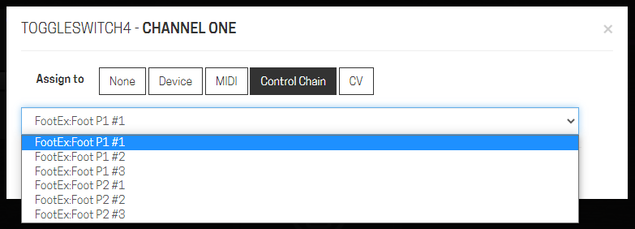
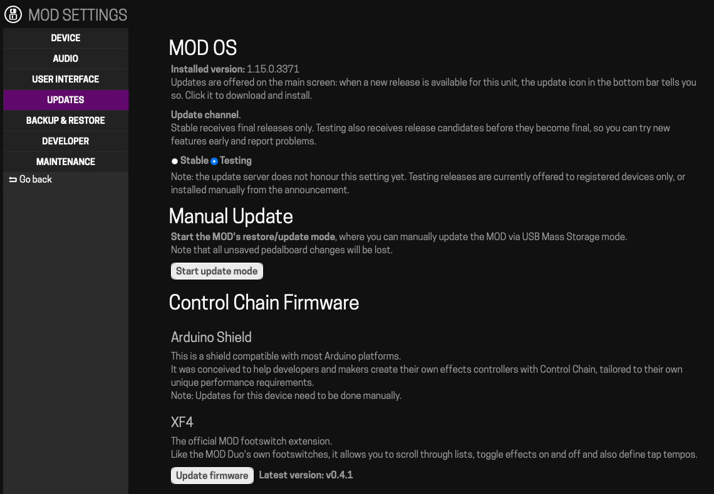

# Control Chain Devices

Control Chain is MOD's open protocol for peripherals like the MOD Footswitch. Compared to MIDI controllers, Control Chain devices offer on-device screens that show what each actuator is currently assigned to, higher control resolution, and the ability to daisy-chain multiple devices (tested up to 8) off a single cable.

Connect via the RJ-45 Control Chain port on the back of the Dwarf.

!!! danger "Not a network port"
    Don't plug the Control Chain port into a regular Ethernet port or network switch — despite the RJ-45 connector, it isn't Ethernet, and connecting it to real network equipment can damage the device.

## Assigning parameters

Once a Control Chain device is connected, it appears as an option in the assignment dialog: select the **Control Chain** tab and choose the interface from the dropdown. If nothing appears connected, double check the cable and that the device is powered.

Control Chain is an open protocol, so it's also possible to build your own peripherals for it — see the [Arduino Shield](https://github.com/mod-audio/cc-hw-arduino-shield) as a starting point.

## Firmware updates

Control Chain devices have their own firmware. The Web UI lists the devices it knows under **Settings → Updates → Control Chain Firmware**, each with the latest firmware version and an **Update firmware** button. Some devices, like the Arduino Shield, are updated by hand instead: the list says so.

!!! warning "Pending implementation — content not final"
    MOD OS 1.15, a test release for now (1.15 RC1), moves this list into the Updates tab. On 1.14 it is in its own Settings tab, **Device Updates**. Remove this box once 1.15 is the stable release.

---

Next: [Bluetooth](bluetooth.md)
