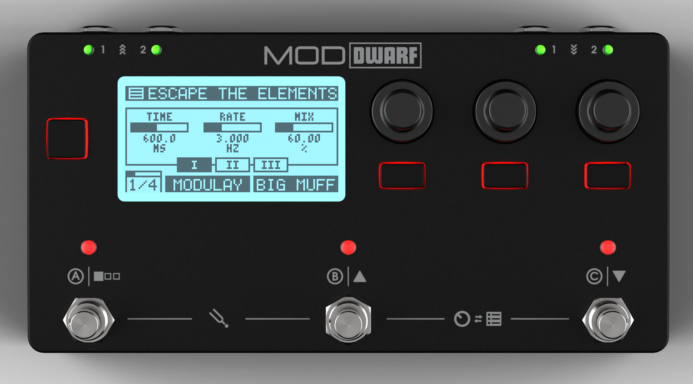

# MOD Dwarf Manual

Welcome to the manual for the **MOD Dwarf**, your modular audio processor.

This manual is organized around what you're trying to do, not around the device's internal architecture — so a single page will walk you through both the hardware controls and the Web UI steps needed for a task, instead of sending you back and forth between separate reference pages.

## Where to start

- New to the Dwarf? Start with **[Getting Started](getting-started/unboxing-safety.md)**.
- Already unboxed and want to build your first sound? Jump to **[Your First Pedalboard](first-pedalboard/web-ui-access.md)**.
- Looking for a specific control or setting? Use the search bar above, or browse **[Reference](reference/tech-specs.md)**.

## About this manual

This manual describes **MOD OS 1.14**, the current stable release. Where something works differently on an earlier release, the page says so in a box marked **New in 1.14** or **Changed in 1.14**. [USB Audio](connecting-gear/usb-audio.md) has an example.

If your Dwarf is on an older release (for example 1.13.5) and a page doesn't match what you see, look for one of these boxes, or [update the Dwarf](maintaining/os-updates.md).

Pages generated as placeholders are marked with a "Status: outline stub" note — if you land on one of those, that section hasn't been written yet.

Source: [github.com/mod-audio/mod-dwarf-manual](https://github.com/mod-audio/mod-dwarf-manual)
