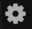
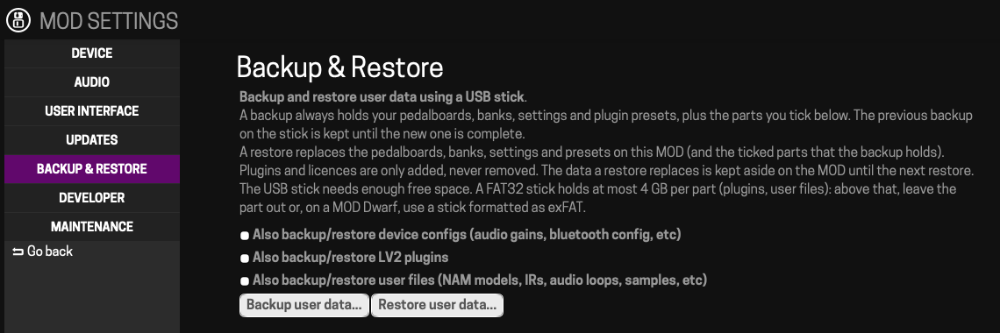

# Backup & Restore

!!! warning "Pending implementation — content not final"
    This page describes Backup & Restore as reworked in MOD OS 1.15, which is a test release for now (1.15 RC1). On 1.14 the buttons are under Settings → Basic, user files cannot be included, and the safeguards described below (the old backup kept until the new one is complete, the replaced data kept aside on the Dwarf) are not there. Remove this box once 1.15 is the stable release.

Back up your Dwarf's data to a USB stick, and restore it later: before a factory reset or an OS update, to move your setup to another Dwarf, or just as routine insurance.

A backup always includes your **pedalboards, banks, settings and plugin presets**, plus your plugin licence keys. You can add three more parts:

- **Device configs**: audio gains, Bluetooth configuration and similar device settings.
- **LV2 plugins**: the plugins you installed.
- **User files**: NAM models, IRs, audio loops, samples and the rest of your files.

## The USB stick

Plug the stick into the USB Host port (A). On the Dwarf, **use a stick formatted as exFAT**: FAT32 cannot hold a file bigger than 4 GB, and a backup with plugins or user files easily gets bigger. The backup goes into a `moddwarf` folder on the stick.

The Dwarf checks there is enough free space before it starts, and tells you if there isn't.

## Creating a backup

1. Plug the USB stick into the USB Host port.
2. In the Web UI, open **Settings → Backup & Restore**.
3. Tick what you want on top of the basics: **Also backup/restore device configs**, **Also backup/restore LV2 plugins**, **Also backup/restore user files**.
4. Click **Backup user data...** and wait. "Exporting data, please wait..." stays up while it runs.
5. When it says **"Backup to USB stick complete! You can now safely remove the USB stick."**, unplug the stick.

**A failed backup never overwrites a good one.** The new backup is written next to the old one, and only replaces it once every part is complete. The stick also keeps the one backup before that.

## Restoring a backup

1. Plug the stick with the backup into the USB Host port.
2. In **Settings → Backup & Restore**, tick the parts you want to restore, the same three checkboxes.
3. Click **Restore user data...**. The Dwarf reads the stick and shows what it found: the date of the backup, the MOD OS it was made with, and each part with its size. A backup made before MOD OS 1.15 is marked as such.
4. Click to continue, and wait: "Restoring data, please wait... This might take a few minutes."
5. When it says **"Restore from USB stick complete!"**, the Dwarf restarts its audio and the Web UI. Click **Reload** after a few seconds.

Before changing anything, the Dwarf reads the whole backup, so a damaged backup is refused and your current data stays as it is. The data a restore replaces is kept aside on the Dwarf until the next restore, and if the restore fails half-way, the previous data is put back.

Plugins and licences are only ever added by a restore, never removed: plugins you installed after the backup stay.

If the USB stick isn't recognized, see [Troubleshooting](../maintaining/troubleshooting.md).

---

Next: [CPU Monitor & Buffer Block](cpu-buffer.md)
