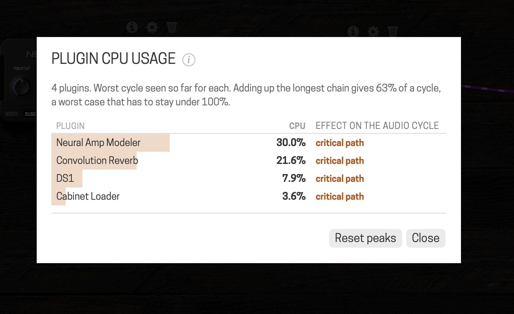
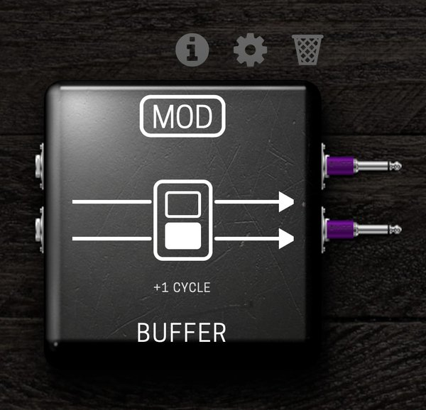
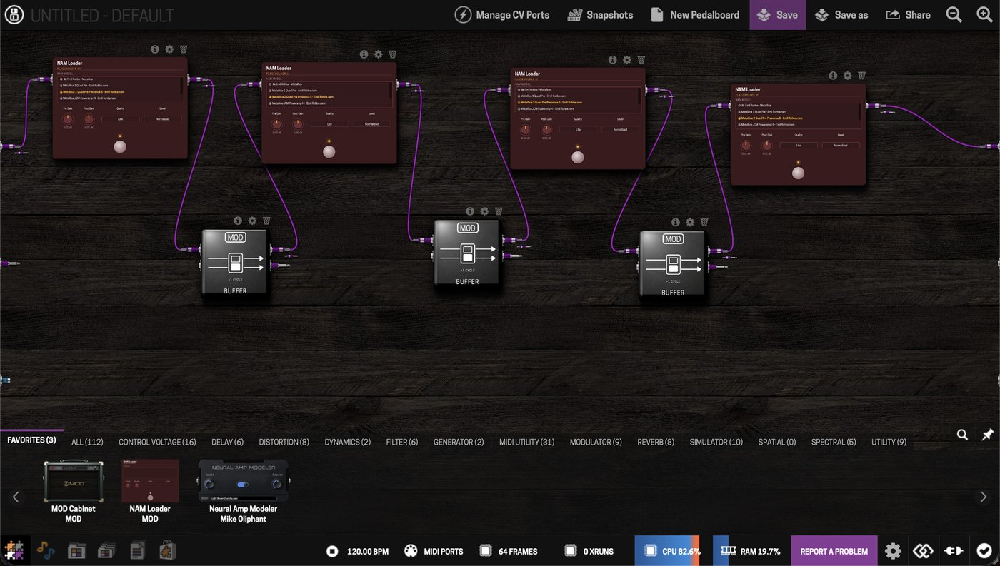

# CPU Monitor & Buffer Block

!!! warning "Pending implementation — content not final"
    The Plugin CPU Usage window and the Buffer block arrive with MOD OS 1.15, which is a test release for now (1.15 RC1). On 1.14 the CPU bar shows the total only, and a chain can be split across cores with the Portal Sink/Source plugin pair. Remove this box once 1.15 is the stable release.

The CPU bar at the bottom of the Web UI shows how loaded the Dwarf is. When it gets close to the limit, audio drops out (xruns). This page shows how to find out which plugins load it, and how the Buffer block lets a heavy pedalboard use more of the Dwarf's processor cores.

## Which plugin takes the CPU

Click the **CPU** bar in the bottom bar. The **Plugin CPU Usage** window opens and lists every plugin of the pedalboard, heaviest first:

- **CPU**: the plugin's worst audio cycle seen so far, as a share of one cycle. It is a peak, not an average, on purpose: a plugin that usually costs 5% but now and then jumps to 60% is the one that drops audio.
- **Effect on the audio cycle**: **critical path** means the plugin is on the longest chain of plugins waiting on each other, and anything you save on it shortens the audio cycle. **N% spare** means it runs alongside something slower and finishes early: making it lighter gains nothing.

So the plugin with the highest CPU figure is not always the one to replace. Look for heavy plugins on the critical path.

The line above the list adds up the longest chain, for example "Adding up the longest chain gives 63% of a cycle, a worst case that has to stay under 100%." Because it adds up peaks that rarely happen in the same cycle, it reads higher than the CPU bar.

- **Reset peaks** clears the peaks, for a fresh reading after you change something or before a passage you are about to play.
- Click a plugin in the list to jump to it on the pedalboard.
- **Close**, or a click outside the window, closes it. The **i** button explains the numbers.

The Dwarf only measures while the window is open, so it costs nothing the rest of the time. Work a plugin hands to a background thread is not counted.

## The Buffer block

The Dwarf has several processor cores, but a chain of plugins one after the other has to run in order, on one core at a time. A long, heavy chain can max out one core while the others sit idle.

The **Buffer** block splits that chain. Everything connected before a Buffer and everything connected after it are processed at the same time, on different cores. The price is latency: the signal comes out of the Buffer unchanged, but one audio cycle later (one buffer size: 2.7 ms at the default 128 frames).

The Buffer is built into MOD OS: you don't install it from the Plugin Store. Find it in the plugin bar under **Utility**, and drag it into the pedalboard like any plugin. It has two inputs and two outputs, for mono or stereo, no controls and no bypass. You can use as many as you need; each one adds a cycle of latency to the path it is on.

### Where to put it

1. Open the Plugin CPU Usage window and find the heavy plugins on the critical path.
2. Put a Buffer in the middle of that chain, so each half carries about the same load. In the picture above, four NAM Loaders run in a row with a Buffer between each pair.
3. Check the CPU window again: the longest chain should now be shorter.

**Watch out for parallel paths.** If a signal splits and the two paths meet again, for example a dry path and an effects path into a mixer, send both through the same number of Buffers. A buffered path mixed with a direct one is one cycle late, and the two copies comb-filter (phasing).

Before going up to 256 frames for a heavy pedalboard, try a Buffer: it costs one cycle on that path, where 256 frames doubles the latency of everything. See [Buffer size](../settings/web-ui-settings.md#buffer-size).

---

Next: [Using CV (Control Voltage)](using-cv.md)
