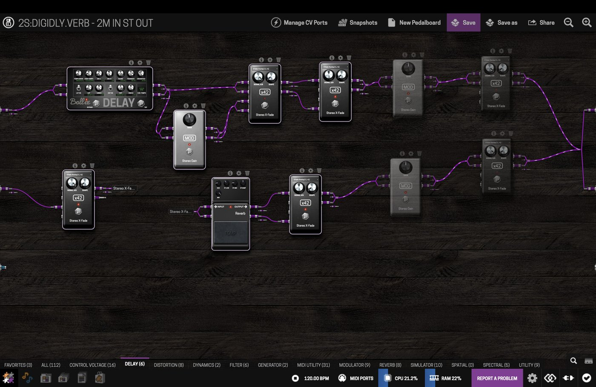
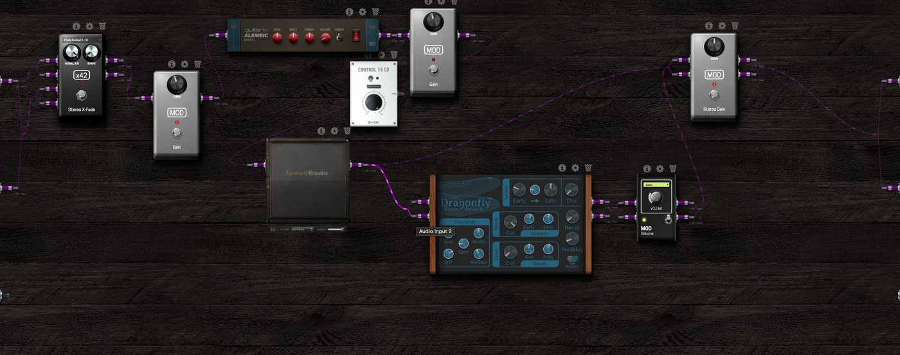
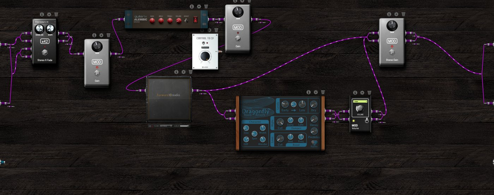
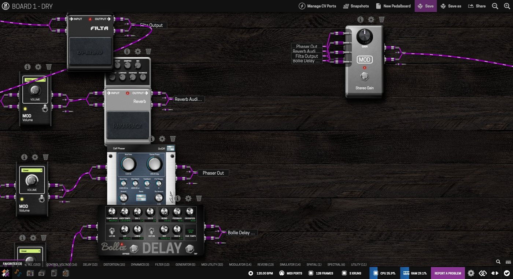

# Editing a Pedalboard

!!! warning "Pending implementation — content not final"
    Everything on this page arrives with MOD OS 1.15, which is a test release for now (1.15 RC1). On 1.14 you move and delete plugins one at a time, the mouse wheel does not zoom, and every cable is drawn in full. Remove this box once 1.15 is the stable release.

Tools for working on big pedalboards in the Web UI: selecting several plugins, zooming, following cables, merging stereo pairs and "teleporting" long cables. Most of these features come from Starless, a community project by MOD users.

## Selecting several plugins

| Action | Result |
|---|---|
| **Shift** + drag on the background | Draws a rectangle; every plugin it touches is selected |
| **Shift** + click a plugin | Adds it to the selection, or takes it out |
| Drag one of the selected plugins | Moves the whole group |
| **Delete** or **Backspace** | Removes the selected plugins |
| Drag on the background (no Shift) | Moves the view and clears the selection |

Selected plugins stay bright; the rest of the pedalboard is dimmed.

Removing more than one plugin asks first ("Remove N plugins from the pedalboard?"), because there is no undo. The Delete key does nothing while you are typing in a text box.

## Zooming and moving around

| Action | Result |
|---|---|
| Mouse wheel over the background | Zooms in and out around the pointer |
| Pinch (trackpad, tablet) | Zooms in and out |
| Double-click the background | Zooms out |
| Mouse wheel over a knob | Turns the knob |
| Mouse wheel over an open list | Scrolls the list |

The Web UI decides what the wheel does at the start of each movement and sticks to it: a zoom that started over the background never turns a knob that slides under the pointer. A short pause ends the movement.

When a pedalboard loads, the view is scaled so the whole board fits the window, and it fits again when you resize the window.

## Following a cable

Hover the mouse over a jack that has cables: all its cables light up, with the jacks at both ends. On a crowded board this is the quickest way to see where a signal comes from and where it goes.

**Right-click** a jack with cables for a small menu:

- **Split cable** / **Join cable** (shortcut **s**): see [Cable teleporting](#cable-teleporting).
- **Disconnect**: removes the cable.

With several cables on the jack the items act on all of them: **Split cables**, **Join cables**, **Disconnect all**. A jack without cables keeps the browser's usual menu.

## Stereo cables

A stereo connection is really two cables, left and right, running side by side. With **Merge stereo cables** on (Settings → User Interface, off by default; see [Web UI Settings](../settings/web-ui-settings.md#user-interface)), the pair is drawn as a single cable that only splits into its two legs at the ends.

These are merged:

- a stereo pair wired straight across, left to left and right to right;
- a mono output into both halves of a stereo input;
- a stereo output into one mono input.

A pair wired crossed (left to right, right to left) stays as two cables, so a deliberate swap stays visible.

The Web UI recognises a pair by the port names: ending in L/R or Left/Right, or numbered ports 1-2, 3-4.

## Cable teleporting

A long cable across the whole board makes everything else harder to read. You can **split** it: the connection stays exactly as it was, but instead of a wire across the board you get a short stub with a label box at each end.

- **Split**: hover a jack with a cable and press **s**, or right-click it and choose **Split cable**.
- **Join** again: the same, **s** or **Join cable**.
- **Rename**: click the label box on the output side, type the name and press **Enter** (**Escape** cancels). Each name has to be unique on the pedalboard; a name already in use is refused. Clearing the name joins the cable again.

A new split cable is named after the plugin and the port it leaves from, with a number added if that name is taken. A stereo pair is split and joined together and shares one label.

The label boxes on the input side can't be edited. When several split cables arrive at the same input, a small count appears on its box: click it to fan them out.

Split cables are saved with the pedalboard, names included. The size of the labels is set with **Teleport label size** in Settings → User Interface.

The **s** key does nothing while you are typing or dragging a cable.

---

Next: [Drag & Replace Plugin](drag-replace.md)
