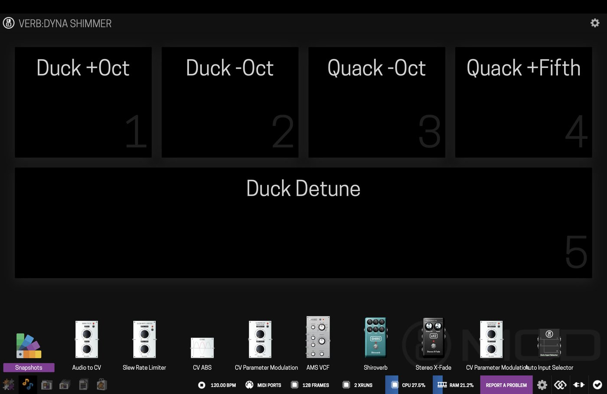
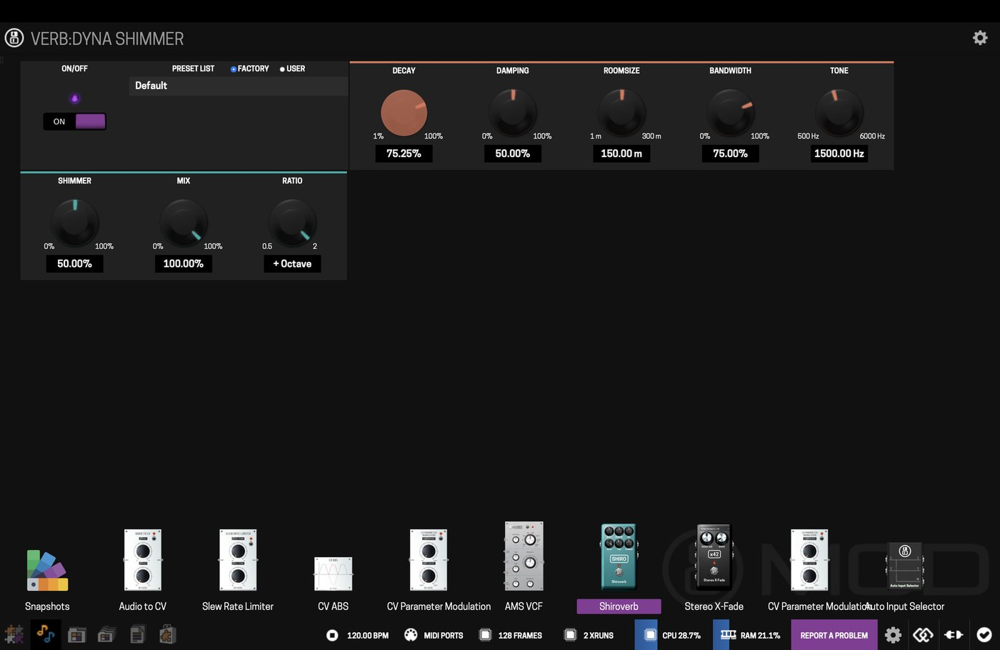
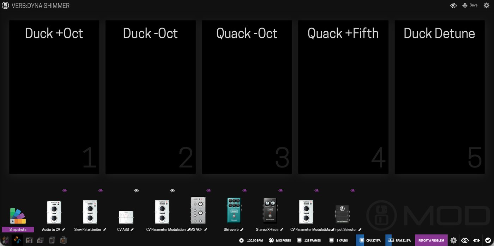

# Performance View (Web UI)

!!! warning "Pending implementation — content not final"
    The Performance view arrives with MOD OS 1.15, which is a test release for now (1.15 RC1). On 1.14 the Web UI only has the Constructor. Remove this box once 1.15 is the stable release.

The Performance view is a stage-friendly page of the Web UI: big tiles for your snapshots, and each plugin's controls one tap away, without the pedalboard's cables. It works well on a phone or tablet next to the Dwarf, for a soundcheck or a rehearsal.

## Opening it

Click the **Performance** icon in the bottom-left corner of the Web UI, next to the Constructor icon. On a phone or tablet the Web UI opens in the Performance view by itself.

## Using it

The row at the bottom holds one tile per plugin, after a first tile called **Snapshots**.

- **Snapshots**: shows the pedalboard's snapshots as big numbered tiles. Tap one to load it. See [Snapshots](../first-pedalboard/snapshots.md).
- **A plugin**: shows that plugin's controls and its preset list. Turn the knobs and switch presets as on the pedalboard. Saving, renaming or deleting presets is done in the plugin's settings window in the Constructor.

With a mouse, the wheel over the tile row moves to the next or previous tile.

## Choosing the plugins and their order

Click the gear icon at the top right to enter edit mode. There you can:

- **Hide or show a plugin**: the eye icon at the top switches between all plugins and only the visible ones. With all plugins shown, each tile has its own eye icon: click it to hide or show that plugin.
- **Change the order**: drag a tile onto another to swap them.
- **Rename a plugin**: click its label. Useful with two of the same plugin, for example "Delay short" and "Delay long". The same label can be set in the plugin's settings window in the Constructor.

Then click **Save**. The labels, visibility and order are stored in the pedalboard, so they come back every time you load it. A plugin you add later is visible and goes to the end.

---

Next: [LED Meters](led-meters.md)
