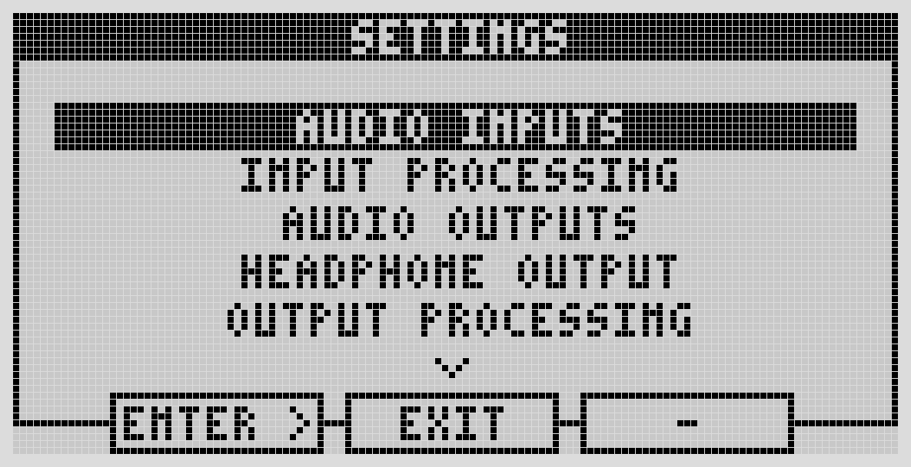
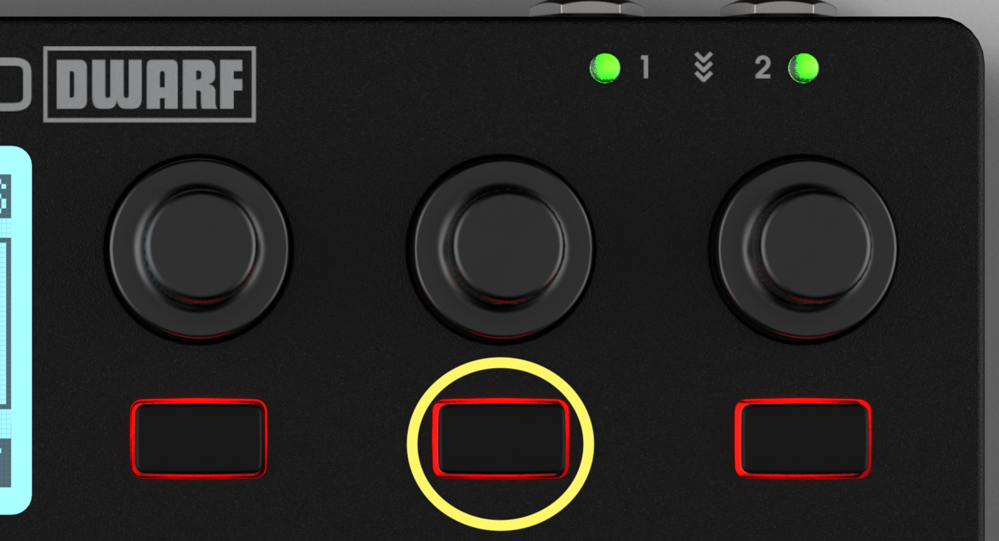
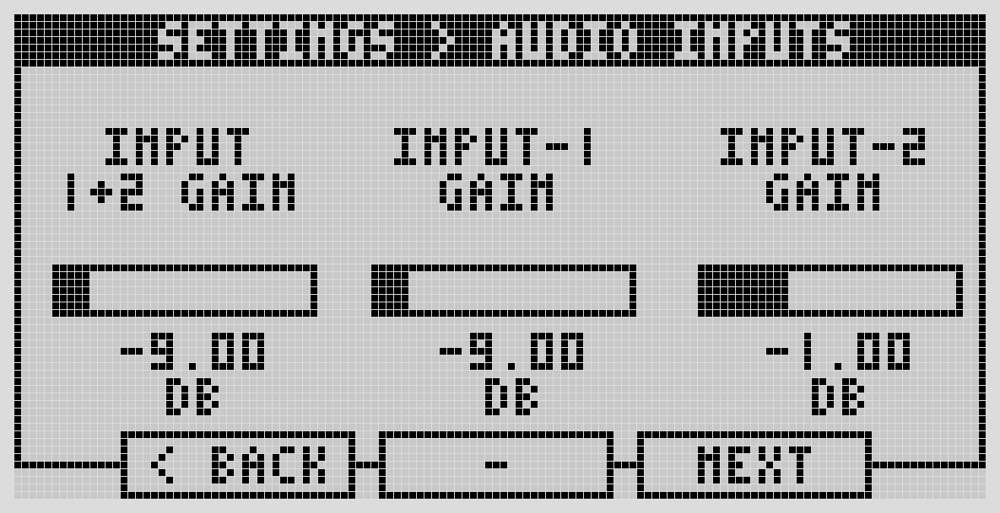
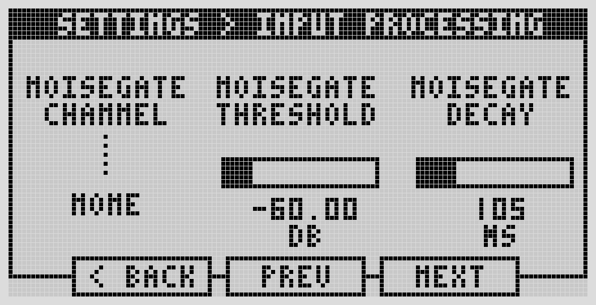
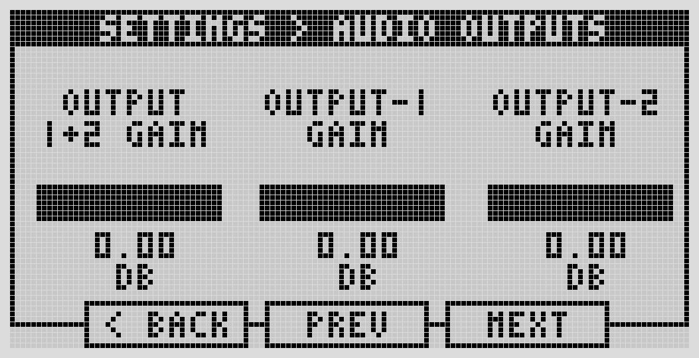
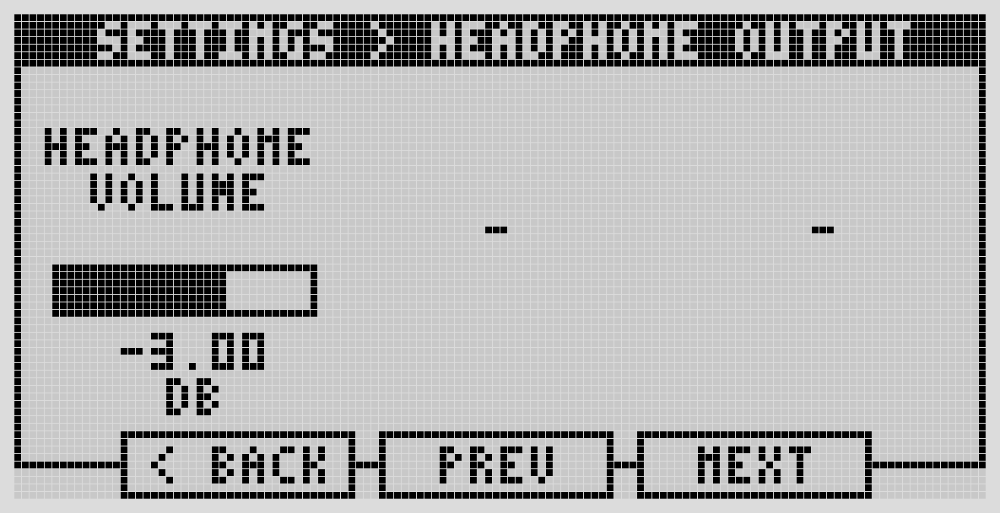
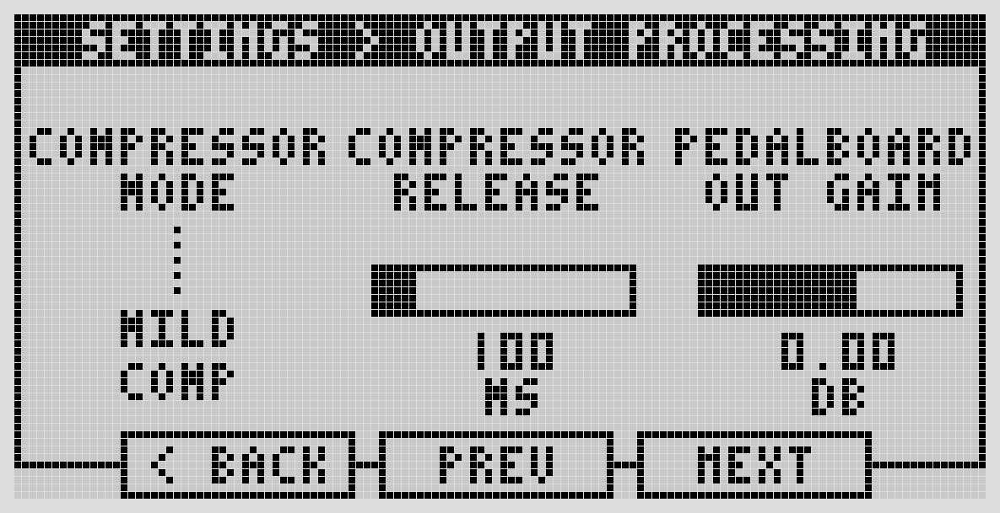

# Audio I/O & Headphone

Reach these from the device: press the Menu button, then the center button, to open Settings. Scroll with the left-most encoder, press it (or the leftmost button) to open a submenu, and press the center button to exit.

## Analog Inputs

<!-- IMAGE NEEDED: The ANALOG INPUTS screen of MOD OS 1.15, showing the gain and the max input level in dBu under it -->

Input gain goes from **0dB to +24dB, in 0.5dB steps** (MOD OS 1.15 and later). Before 1.15 this menu was called Audio
Inputs.

Under the gain, the screen shows the loudest level the input takes at that setting, in dBu: for example **+6.0dB** with
**+1.8dBu** under it. A source louder than that makes the input LED red. See
[Input sensitivity](#input-sensitivity) for the whole range.

- Left-most encoder — both inputs together.
- Center encoder — input 1 only.
- Right-most encoder — input 2 only.

Turn for fine adjustment; push-and-turn for coarser steps.

**0dB is the lowest setting and gives the most headroom**: the input stays clean up to +7.8dBu, enough for hot active
pickups, keyboards and most line-level gear. Every step above it adds exactly that much gain: +12dB on the screen is
12dB more than at 0dB. The scale stops at +24dB because above that the input's own noise comes too close to the signal.

### Setting the input gain

1. Start at 0dB.
2. Play as loud as you will on stage: hardest strumming, instrument volume up.
3. Turn the gain up until the [input LED](../playing-live/led-meters.md) turns yellow on the strongest notes.
4. If it turns red, turn the gain down by about 3dB. Red on an input LED means that input is clipping.

More gain does not make the input quieter: its noise rises together with the signal. So use the lowest setting that
gets your loudest playing into the yellow, not more.

Typical starting points:

| Source | Start at |
|---|---|
| Active pickups, active basses, keyboards, line-level gear | 0dB |
| Humbuckers | 0dB to +6dB |
| Single coils | +6dB to +12dB |
| Vintage or low-output pickups, soft playing | +12dB to +24dB |

If the input LED is red even at 0dB, the source is hotter than the input can take (above +7.8dBu): lower the level at
the source, for example the instrument's volume or the output of the gear before the Dwarf.

### Input sensitivity

The input level that reaches full scale (the input LED turns red) at each setting. This is the dBu value the screen
shows under the gain:

| Input gain | Full scale at the input |
|---|---|
| 0dB | +7.8dBu (1.9V RMS) |
| +6dB | +1.8dBu (0.95V RMS) |
| +12dB | −4.2dBu (0.48V RMS) |
| +18dB | −10.2dBu (0.24V RMS) |
| +24dB | −16.2dBu (0.12V RMS) |

In between, subtract the gain from +7.8dBu: at +9.5dB, full scale is −1.7dBu.

When you update from an older MOD OS, your input gain keeps the same real gain: only the number on the screen changes.

## Input Processing

A built-in noise gate, per input or both simultaneously (or off). Configurable threshold and decay.

## Analog Outputs

<!-- IMAGE NEEDED: The ANALOG OUTPUTS screen of MOD OS 1.15, showing OUT-1 MAX LEVEL in dBu TS -->

Adjustable over 127dB, in 0.5dB steps, using the same left/center/right encoder pattern as inputs (both / output 1 /
output 2). Before 1.15 this menu was called Audio Outputs.

Since MOD OS 1.15 the screen shows the **maximum output level**: the level a full-scale signal leaves the output at,
in dBu, for an unbalanced (TS) cable. At the top of the range it reads **+3.5 dBu TS**; every step down lowers it by
0.5dB. With a balanced (TRS) cable into a balanced input, the level is about 6dB higher than the screen shows.

At the top of the range, a full-scale signal leaves the outputs at:

| Cable | Maximum output level |
|---|---|
| Balanced (TRS) | **+9.4dBu (2.3V RMS)** |
| Unbalanced (TS) | **+3.5dBu (1.16V RMS)** |

The outputs are balanced, so a TRS cable into a balanced input gives 6dB more level than a TS cable. The outputs stay
clean right up to full scale.

### Matching the level of your dry signal

The input and output full-scale levels are not the same, so with input gain at 0dB and the outputs at the top of their
range the Dwarf does not pass your signal at exactly the level it receives:

| Output cable | Level through the Dwarf (input 0dB, output +3.5 dBu TS) | To match the dry signal |
|---|---|---|
| Unbalanced (TS), e.g. into a guitar amp | 4.3dB quieter | input gain **+4.5dB** |
| Balanced (TRS) into a balanced input | 1.6dB louder | output 1.5dB down (**+2.0 dBu TS** on the screen) |

This assumes a pedalboard that does not change the level itself (plugins at unity, pedalboard output gain in
[Output Processing](#output-processing) at 0dB). If your playing needs more input gain than that (see
[Setting the input gain](#setting-the-input-gain)), set the input first, then bring the level back down with the
output.

## Headphone Output

Digital volume, -33dB to +12dB in 3dB steps. Mirrors outputs 1 and 2.

## Output Processing

A built-in compressor with three intensities (light, mild, heavy) or off, plus a configurable release time. This section also sets the pedalboard output gain — the last digital gain stage before the signal goes analog.

---

Next: [MIDI Settings](midi.md)
