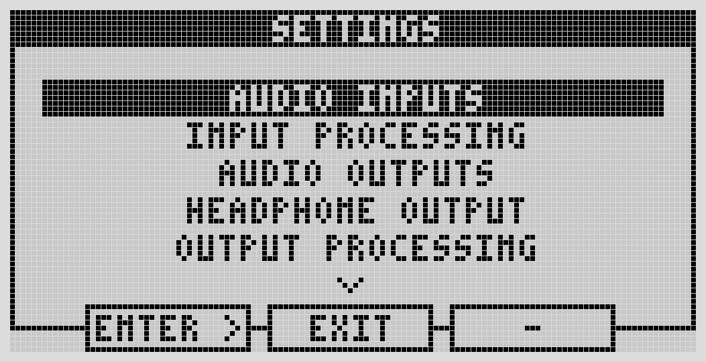
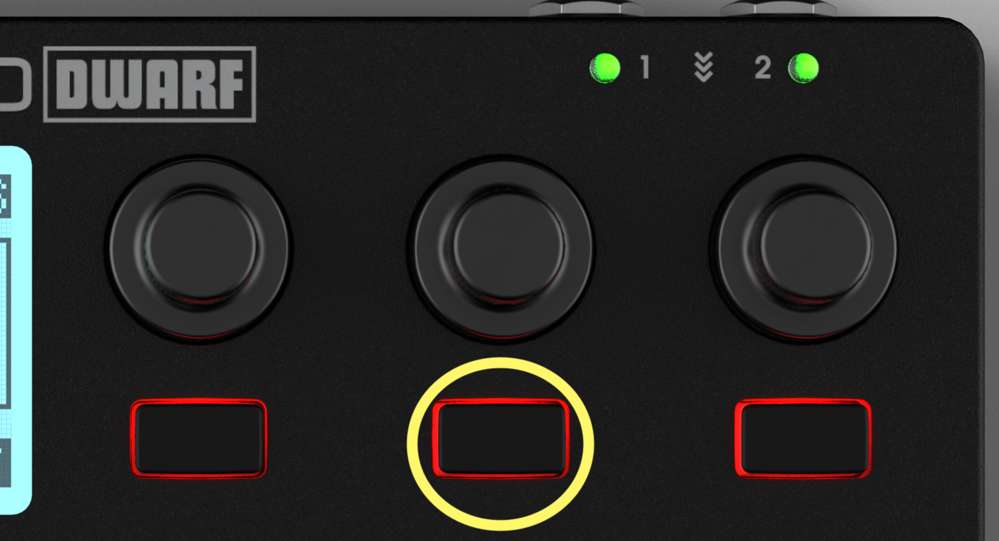
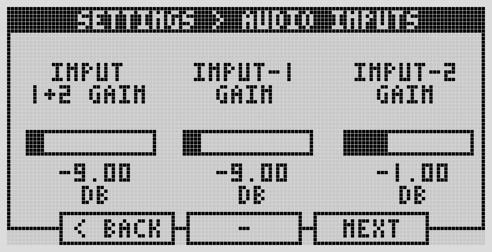
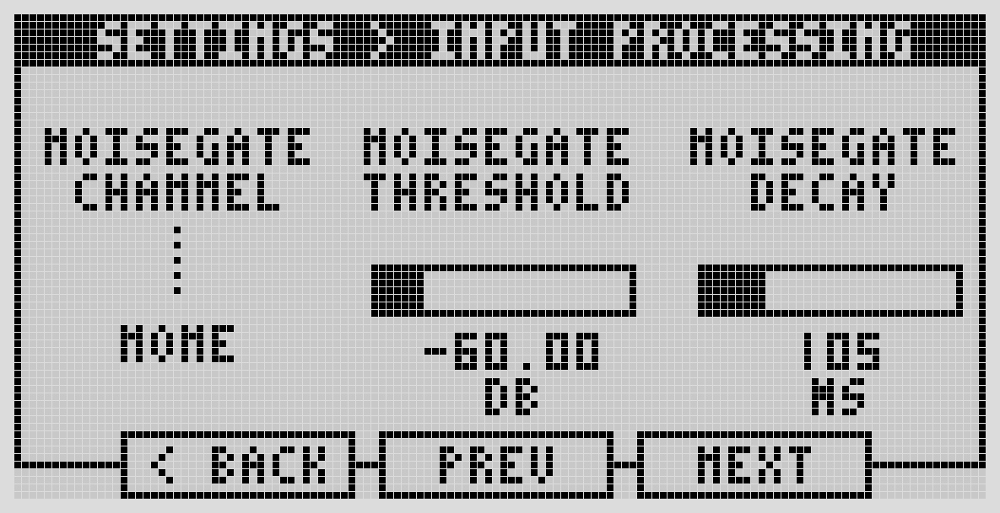
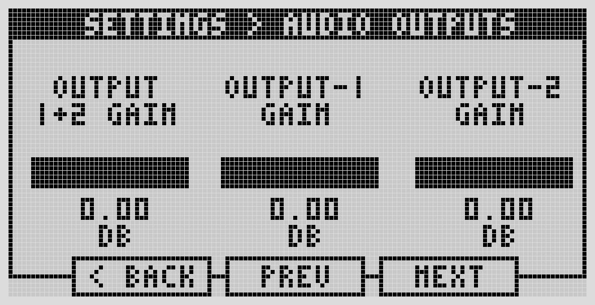
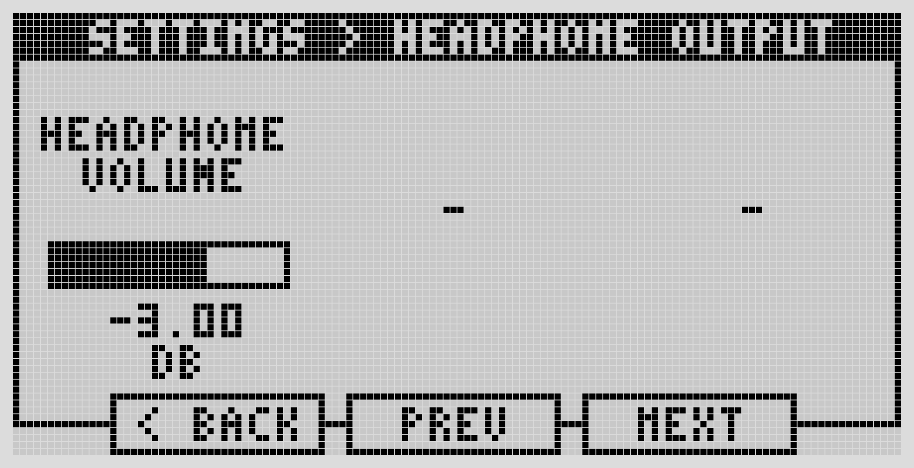
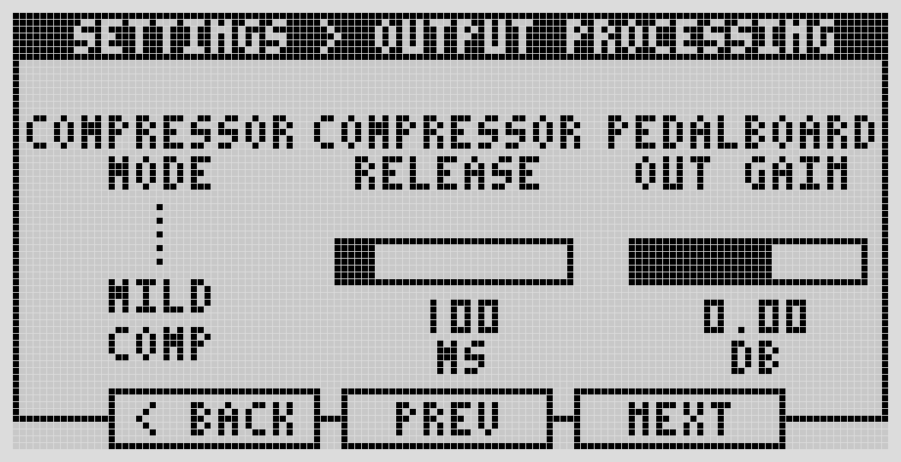

# Audio I/O & Headphone

Reach these from the device: press the Menu button, then the center button, to open Settings. Scroll with the left-most encoder, press it (or the leftmost button) to open a submenu, and press the center button to exit.

## Audio Inputs

Input gain goes from **0dB to +24dB, in 0.5dB steps** (MOD OS 1.15 and later).

- Left-most encoder — both inputs together.
- Center encoder — input 1 only.
- Right-most encoder — input 2 only.

Turn for fine adjustment; push-and-turn for coarser steps.

**0dB is the lowest setting and gives the most headroom**: the input stays clean up to +7.8dBu, enough for hot active
pickups, keyboards and most line-level gear. Every step above it adds exactly that much gain: +12dB on the screen is
12dB more than at 0dB. The scale stops at +24dB because above that the input's own noise comes too close to the signal.

### Setting the input gain

1. Start at 0dB.
2. Play as loud as you will on stage: hardest strumming, instrument volume up.
3. Turn the gain up until the [input LED](../playing-live/led-meters.md) turns yellow on the strongest notes.
4. If it turns red, turn the gain down by about 3dB. Red on an input LED means that input is clipping.

More gain does not make the input quieter: its noise rises together with the signal. So use the lowest setting that
gets your loudest playing into the yellow, not more.

Typical starting points:

| Source | Start at |
|---|---|
| Active pickups, active basses, keyboards, line-level gear | 0dB |
| Humbuckers | 0dB to +6dB |
| Single coils | +6dB to +12dB |
| Vintage or low-output pickups, soft playing | +12dB to +24dB |

If the input LED is red even at 0dB, the source is hotter than the input can take (above +7.8dBu): lower the level at
the source, for example the instrument's volume or the output of the gear before the Dwarf.

When you update from an older MOD OS, your input gain keeps the same real gain: only the number on the screen changes.

## Input Processing

A built-in noise gate, per input or both simultaneously (or off). Configurable threshold and decay.

## Audio Outputs

Adjustable 0dB to -127dB, in 0.5dB steps, using the same left/center/right encoder pattern as inputs (both / output 1 / output 2).

## Headphone Output

Digital volume, -33dB to +12dB in 3dB steps. Mirrors outputs 1 and 2.

## Output Processing

A built-in compressor with three intensities (light, mild, heavy) or off, plus a configurable release time. This section also sets the pedalboard output gain — the last digital gain stage before the signal goes analog.

---

Next: [MIDI Settings](midi.md)
