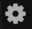
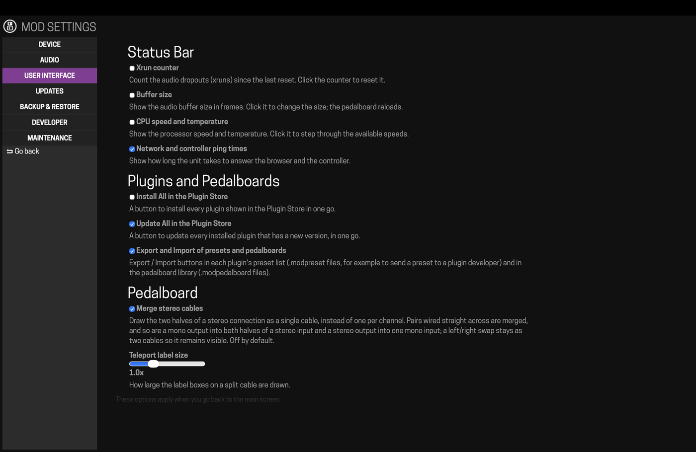

# Web UI Settings

!!! warning "Pending implementation — content not final"
    The Settings page described here arrives with MOD OS 1.15, which is a test release for now (1.15 RC1). On 1.14 the page has four tabs instead: Basic, Advanced, Device Updates and Dangerous, with a single Developer Mode switch. Remove this box once 1.15 is the stable release.

The device menus (see [Audio I/O & Headphone](audio-io.md)) hold everything you change while playing. The Web UI has its own Settings page for the rest: buffer size, backups, what the Web UI shows, updates and maintenance.

Open it from the **Settings** button in the bar at the bottom of the Web UI.

The page has seven tabs, listed on the left: Device, Audio, User Interface, Updates, Backup & Restore, Developer and Maintenance. **Go back** returns to the main screen.

## Device

Information about your Dwarf: unit, build date, OS version, kernel, and the audio engine's current **buffer size**, sample rate and DSP load. Also here:

- **Use custom Bluetooth device name**: the name your computer or phone sees when pairing (see [Bluetooth](../connecting-gear/bluetooth.md)).
- **Reboot MOD**: restarts the Dwarf. Unsaved pedalboard changes are lost.

## Audio

- **Copy mono output buffer to unused channel**: when one output has nothing connected in the pedalboard, it gets the same signal as the other. Takes effect after a reboot.
- **Buffer Size**: see below.

### Buffer size

<!-- IMAGE NEEDED: Settings → Audio of MOD OS 1.15 with the Buffer Size choices 64 / 128 (default) / 256 frames
     Suggested: docs/assets/settings/web-settings-buffer-size.png -->

The buffer size is how much audio the Dwarf processes at a time, in frames (samples). Pick one of three:

- **128 frames** is the default. It is the right choice for almost everything.
- **256 frames** gives plugins twice as long to do their work, so a pedalboard that is too heavy at 128 frames may run cleanly. The price is twice the latency (the delay between playing a note and hearing it).
- **64 frames** halves the latency, but leaves plugins half the time per cycle. A pedalboard that is fine at 128 frames can drop out at 64. Use it for light pedalboards where the lowest possible latency matters.

Changing the buffer size restarts the audio and reloads the pedalboard you have open, so expect a moment of silence. Unsaved changes are kept. The setting is remembered across reboots.

At 128 frames and 48 kHz, one buffer is 2.7 ms; at 64 frames, 1.3 ms; at 256 frames, 5.3 ms.

If a pedalboard is close to the limit, try the [Buffer block](../pedalboards-snapshots/cpu-buffer.md) before going up to 256 frames.

## User Interface

Switches for what the Web UI shows. They apply when you go back to the main screen.

**Status Bar**: extra readouts in the bar at the bottom of the main screen.

- **Xrun counter**: counts the audio dropouts (xruns) since the last reset. Click the counter to reset it.
- **Buffer size**: shows the buffer size in frames. Clicking it switches between 128 and 256 frames, and the pedalboard reloads. For 64 frames use the Audio tab.
- **CPU speed and temperature**: click it to step through the available processor speeds.
- **Network and controller ping times**: how long the Dwarf takes to answer the browser and the device's controller.

**Plugins and Pedalboards**

- **Install All in the Plugin Store**: a button that installs every plugin shown in the [Plugin Store](../first-pedalboard/building.md#installing-plugins) in one go.
- **Update All in the Plugin Store**: a button that updates every installed plugin that has a new version, in one go.
- **Export and Import of presets and pedalboards**: the buttons described in [Sharing Presets & Pedalboards](../plugins-files/sharing.md).

**Pedalboard**

- **Merge stereo cables**: draws a left/right pair of cables as one. Off by default. See [Editing a Pedalboard](../pedalboards-snapshots/editing.md#stereo-cables).
- **Teleport label size**: how big the labels of a [split cable](../pedalboards-snapshots/editing.md#cable-teleporting) are drawn, from 0.6x to 2x (1.0x by default).

These switches are off until you turn them on. If you had Developer Mode on in 1.14, they start out on after the update: 1.15 replaces that one switch with these.

## Updates

- **Installed version** of MOD OS, and the **Update channel** (Stable or Testing). Testing is not honoured by the update server yet: test releases are installed by hand, see [Trying a test release](../maintaining/os-updates.md#trying-a-test-release).
- **Start update mode**: puts the Dwarf in update mode for a [manual update](../maintaining/os-updates.md#manual-update-maintenance-recovery-path), the same as Settings → System Upgrade on the device.
- **Control Chain Firmware**: updates for connected [Control Chain devices](../connecting-gear/control-chain.md).

New releases themselves are offered by the update icon in the bottom bar, not here: see [Installing OS Updates](../maintaining/os-updates.md).

## Backup & Restore

Backs up your data to a USB stick and restores it. See [Backup & Restore](../pedalboards-snapshots/backup-restore.md).

## Developer

- **Show beta plugins in the Store**: lists beta plugins in the Plugin Store, with an Official / Beta / Both filter. Beta plugins can be unstable and cause crashes. A pedalboard you share that uses beta plugins only works for people who also accept beta plugins.
- **JACK Net Manager (EXPERIMENTAL)**: an experimental service. Like every extra service, it uses some CPU: leave it off unless you need it.
- **Automatically restart controller screen**: tries to detect when the device screen locks up and restarts it. It can get this wrong and restart the screen by mistake. Takes effect after a reboot.

## Maintenance

- **Report a problem...**: see [Reporting a Problem](../maintaining/report-problem.md).
- **Reflash controller**: reinstalls the firmware of the device's screen and controls. You type REFLASH to confirm; do not cut the power while it runs. See [Factory Reset & Reinstall](../maintaining/factory-reset.md).
- **Delete user data**: erases what you tick: the favorite plugin list, device settings, plugin license keys, all banks, all pedalboards, all plugins. You type DELETE to confirm. [Back up](../pedalboards-snapshots/backup-restore.md) first: there is no undo.

---

Next: [MIDI Settings](midi.md)
